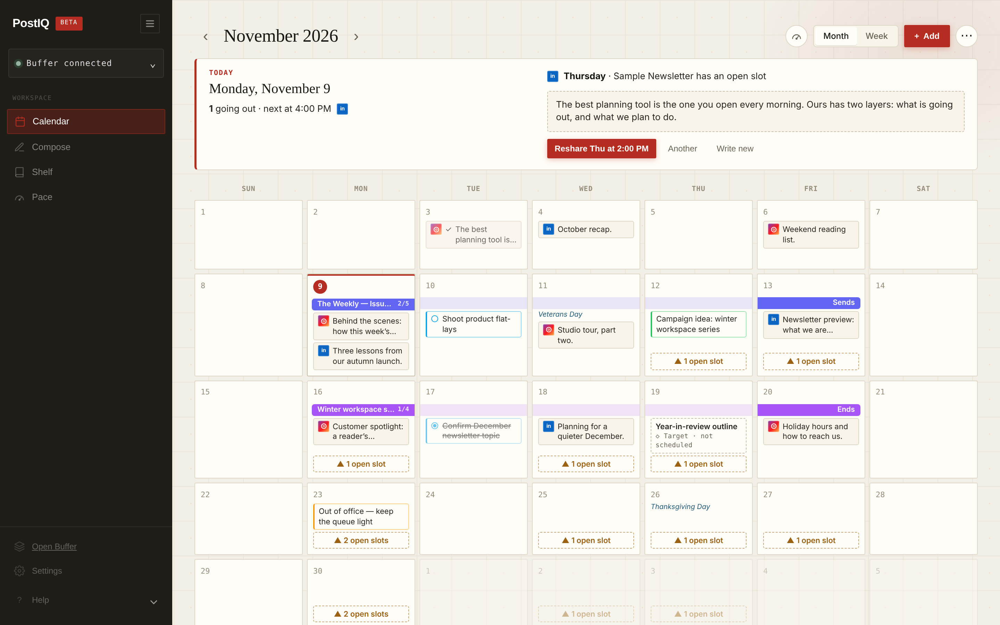
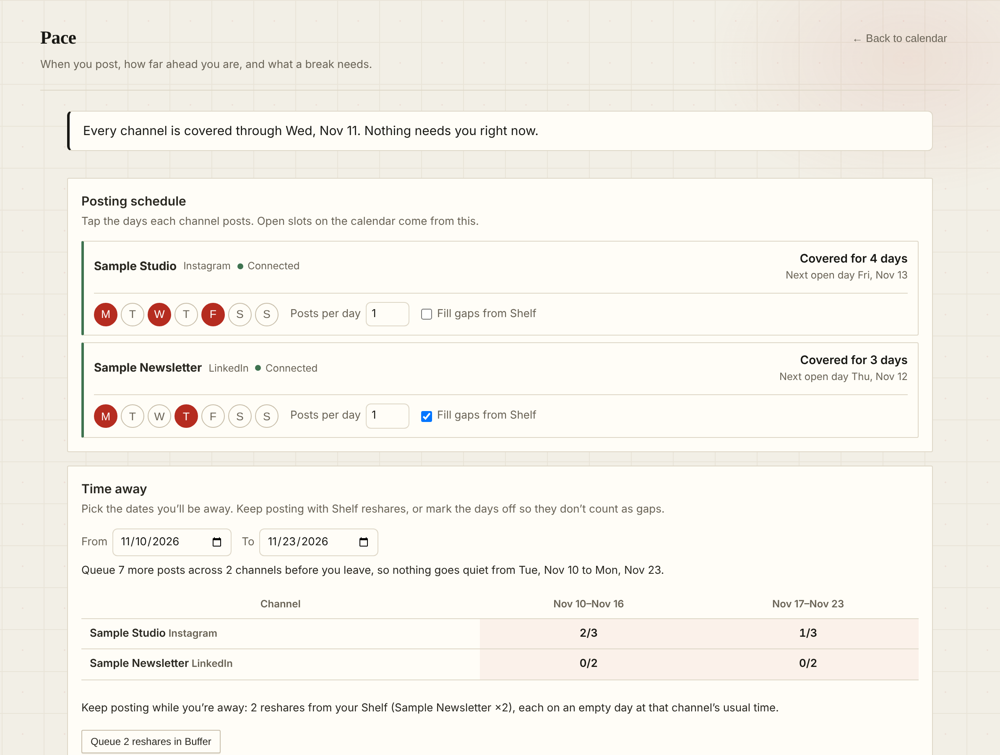
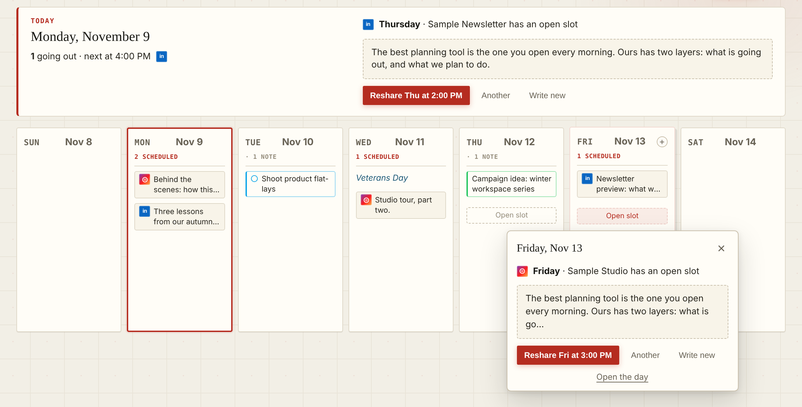
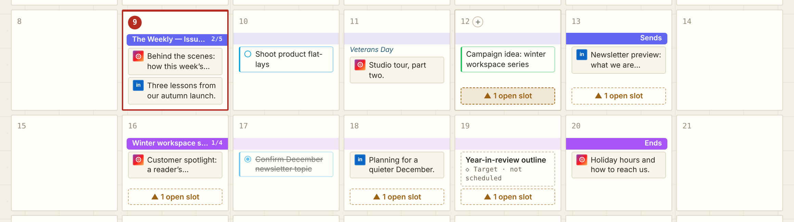
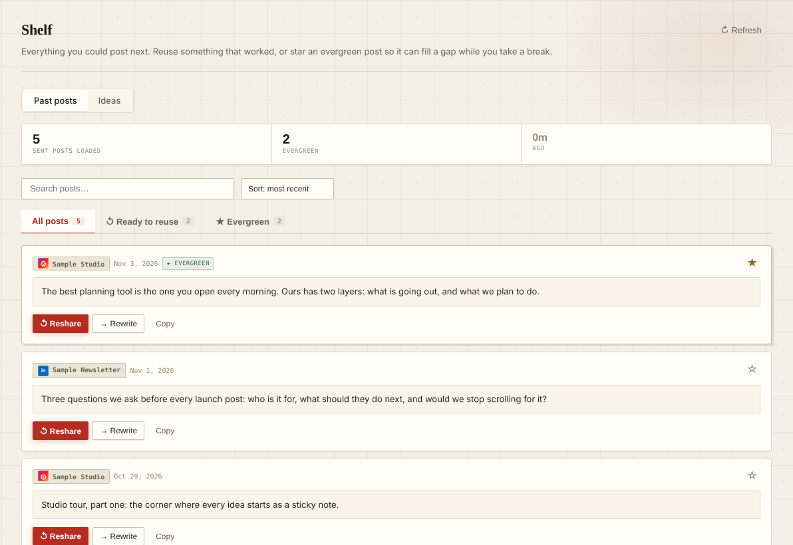

<div align="center">

# PostIQ

### Buffer publishes. *PostIQ plans.*

The calm calendar that sits beside your Buffer queue.<br>
See how far ahead you are, fill the gaps, send to Buffer.

[](https://postiq.netlify.app)




<sub>Sample data. Independent, and not endorsed by Buffer.</sub>

</div>

---

## The whole idea, in one line

```
 see how far ahead you are  ──▶  fill the gap or write something  ──▶  send to Buffer
```

**PostIQ is free during the public beta.** You'll need a Buffer account to connect your queue; your Buffer plan is separate and set by Buffer.

Buffer is great at publishing. PostIQ is the planning layer around it: what's queued, what's planned, and which posting days are still empty. Nothing reaches Buffer until you press a button.

## Reading the calendar

```
  MON            TUE            WED            THU            FRI
┌────────────┐ ┌────────────┐ ┌────────────┐ ┌────────────┐ ┌────────────┐
│███ Issue 14│ │░░░░░░░░░░░░│ │░░░░░░░░░░░░│ │░░░░░░░░░░░░│ │░░░░░ Sends │  ← a newsletter band
│■ Reel 3pm  │ │○ Film reel │ │■ Thread 9am│ │┆ open slot┆│ │■ LinkedIn  │  ← posts, a plan, an open slot
│■ LinkedIn  │ │            │ │            │ │            │ │            │
└────────────┘ └────────────┘ └────────────┘ └────────────┘ └────────────┘
```

| You see | It means |
|---|---|
| **Solid card** ■ | A real post in your Buffer queue (or already published) |
| **Outlined card** ○ | Your plan: a note, a to-do, or an idea with a target date. Never sent anywhere. |
| **Dashed slot** ┆ | A posting day from your schedule with nothing queued yet. Tap it to fill it. |
| **Band across days** ████ | A newsletter or campaign: solid on the first and last day, a light tint between |

---

## What's inside

### 📅 The calendar
Month, week and list views. A one-row toolbar (`‹ November ›` · Month/Week · **+ Add** · **⋯**). The **Today** card shows what's going out today, your to-dos, and your next open slot. Platform icons tell your channels apart, even when two of them are both called "Ben Campbell". Public holidays come from Nager.Date, for the country you pick.

### 🧭 Pace


Know how far ahead you are, and take a break without going quiet.

- Tap the days each channel posts and how many posts per day. That's your posting schedule.
- Every channel says **Covered for 4 days · Next open day Tue**, or **Today is open**.
- One line at the top sums it up: who needs something soon, and that the rest are fine.
- **Time away:** pick the dates. Queue reshares from your Shelf on the empty days, or **mark the days off** so they never count as gaps.

<br clear="right">

### ⚡ One-tap fill


Tap a dashed slot. PostIQ suggests a past post you kept, at that channel's usual time, and the button says exactly what will happen: **Reshare Thu at 2:00 PM**. Don't love it? **Another**. Rather write? **Write new** opens Compose already set to that day.

The fill is picky on purpose:
- A kept post goes out **once per channel**, never on repeat.
- **No text-only reshares** to Instagram, TikTok, YouTube or Pinterest.
- Nothing longer than the platform allows (X 280, Bluesky 300, Threads 500…).

<br clear="right">

### 📰 Newsletters and campaigns


Plan the work, not just the posts. Each issue or campaign sits on the calendar as one band, with stages you tick off (Plan → Draft → Final → Publish → Substack note, all renamable). Open any day in the range to see **Day 3 of 5 · sends Fri, Nov 13 · 2/5 · next: Final**. Shows in month view, week view, the day drawer and the phone agenda.

### ⌨️ Plain English, and dragging real posts
Quick add reads what you'd type to a friend:

```
Fri: film B-roll for the winter series      → a note on Friday
todo tomorrow: review captions              → a to-do for tomorrow
Thanksgiving: holiday hours post            → a note on the holiday
```

Drag a scheduled Buffer post to another day and PostIQ **moves it in Buffer**, with Undo. Open a queued post to edit its text or time, move it back to drafts, or publish now.

### 📚 Shelf


One home for ideas: **Notebook** for notes and links, **Snippets** for hooks, hashtags and templates, **Past posts** where you star the ones worth reusing, and **Trending** when you need a spark. Give an idea a date to see it on the calendar. Pull anything into Compose.

<br clear="right">

### ✍️ Compose
A focused editor with local autosave, media (link, upload or Unsplash), and a character counter that knows each network's real limit. Send as a **draft**, **queue** it, or **schedule** it. Starting from a calendar day sets the schedule to that day for you.

### 🎛️ The extras
- **⌘K command menu** and keyboard shortcuts (below)
- **Shareable snapshots**: a read-only week or month for a client, no login
- **Edit queued posts**: change a post's text or time, send it back to drafts, or publish now
- **.ics export** of your plans, newsletters and campaigns, for Google or Apple Calendar
- **Backup and restore** of your local planning work
- **Five themes**: PostIQ, Classic, After Dark, Studio, Evergreen

---

## Keyboard shortcuts

| Key | Does |
|---|---|
| <kbd>⌘</kbd> <kbd>K</kbd> / <kbd>Ctrl</kbd> <kbd>K</kbd> | Command menu |
| <kbd>N</kbd> | Quick add |
| <kbd>T</kbd> | Jump to today |
| <kbd>←</kbd> <kbd>→</kbd> | Previous / next month or week |
| <kbd>M</kbd> <kbd>W</kbd> <kbd>L</kbd> | Month / week / list |
| Arrow keys, <kbd>Enter</kbd> | Move between days, open one |
| <kbd>?</kbd> | Show all shortcuts |

---

## Buffer Commit, by the numbers

PostIQ was rebuilt during Buffer's **Buffer Commit** window (Oct 28 – Nov 13, 2026).

| | |
|---|---|
| **17** | days |
| **28** | pull requests merged ([#172](https://github.com/kylozenzen/post-iq/pull/172) → [#216](https://github.com/kylozenzen/post-iq/pull/216)) |
| **27.4k** | lines removed (13.1k added) |
| **143** | tests passing |
| **5** | features cut on purpose |

<details>
<summary><b>🪦 The cutting-room floor</b></summary>

<br>

Removed so the calendar could be the product.

| Feature | Where it went |
|---|---|
| Pulse | Archived ([#179](https://github.com/kylozenzen/post-iq/pull/179)) |
| Content Pillars | Archived ([#179](https://github.com/kylozenzen/post-iq/pull/179)) |
| Approvals | Its own product now, Receipts ([#179](https://github.com/kylozenzen/post-iq/pull/179)) |
| Home dashboard | Gone ([#190](https://github.com/kylozenzen/post-iq/pull/190)) |
| AI Assist | Hidden from Compose ([#202](https://github.com/kylozenzen/post-iq/pull/202)) |
| 20,903 lines of dead code | Gone ([#190](https://github.com/kylozenzen/post-iq/pull/190)) |

</details>

<details>
<summary><b>🔧 Fixes you'll never notice (which is the point)</b></summary>

<br>

- The offline shell never installed: it tried to cache 11 files that no longer existed. ([#190](https://github.com/kylozenzen/post-iq/pull/190))
- Open slots reappeared after posts went out. Published posts now count on the day they publish. ([#198](https://github.com/kylozenzen/post-iq/pull/198))
- PostIQ only re-read Buffer when you pressed Sync. It now refreshes on its own, and right after it writes. ([#200](https://github.com/kylozenzen/post-iq/pull/200), [#216](https://github.com/kylozenzen/post-iq/pull/216))
- "Fill my break" queued posts before the break even started. Reshares now land on the actual empty days. ([#216](https://github.com/kylozenzen/post-iq/pull/216))
- Evenings in the US opened the date picker on tomorrow (it used the UTC date). ([#216](https://github.com/kylozenzen/post-iq/pull/216))
- The Unsplash key lived in the browser. Image search goes through a server function now. ([#190](https://github.com/kylozenzen/post-iq/pull/190))

</details>

---

## How it talks to Buffer

PostIQ uses Buffer's public API with OAuth 2.0 + PKCE (a public client, so no secret in the browser).

**It reads:** your channels, your scheduled queue, and recent published posts. It re-reads quietly when its copy is more than a few minutes old: when you open it, when you come back to the tab, every few minutes while it's open, and shortly after it writes.

**It writes only when you do something:**
- Draft, Queue or Schedule from Compose
- One-tap **Reshare** on an open slot, or **Queue reshares** for time away
- **Drag** a scheduled post to a new day (with Undo), or edit, move to drafts, or publish now from the post editor

**It never touches Buffer when you:** change your posting schedule, mark days off, add notes, plan a newsletter, or use Shelf. That all stays in your browser.

Sign out from the sidebar or Settings, or revoke access in Buffer, any time.

---

## Under the hood

| Layer | What |
|---|---|
| Frontend | Plain HTML, CSS and JavaScript. No framework, no build step. |
| Functions | Netlify Functions (Node): Buffer proxy and token exchange, holidays, trending, Unsplash search, app config, admin |
| Auth | Buffer OAuth 2.0 with PKCE |
| Storage | The browser (`localStorage`). Plans, schedules and drafts never leave it unless you export them. |
| Offline | Service worker app shell (`sw.js`), plus a PWA manifest |
| Hosting | Netlify |

```
index.html               landing page
app.html                 the app shell
css/app/                 styles, by area
js/core/                 runtime, navigation, startup
js/integrations/         Buffer auth, API calls, post creation
js/features/             calendar, Today, Pace (suite.js), coverage, campaigns,
                         quick add, command menu, composer, Shelf, holidays, backup
js/library.js            Shelf's past posts
help/                    Help Center
netlify/functions/       serverless functions
scripts/                 project checks, browser checks, screenshot capture
tests/                   node:test suites
images/product/          real-app screenshots (sample data)
brand/                   logo, icons, colors, type, social graphics, motion
```

---

## Run it locally

No build step. Serve the repo root.

```sh
npx serve .          # static only
netlify dev          # with Netlify Functions
```

Checks:

```sh
node --test tests/*.test.js                 # all 144 tests
node scripts/check-project.js               # asset references, syntax, offline cache list
node scripts/smoke-browser.js               # DOM smoke test

# Real-browser checks (need Chrome or Chromium)
CHROMIUM_PATH=/path/to/chrome node scripts/check-calendar-browser.js
CHROMIUM_PATH=/path/to/chrome node scripts/check-planning-tools-browser.js
CHROMIUM_PATH=/path/to/chrome node scripts/check-landing-tour-browser.js

# Regenerate the landing screenshots and share image from the real app, with sample data
CHROMIUM_PATH=/path/to/chrome node scripts/capture-landing-screenshots.js
```

## Environment variables

Set in Netlify → Site configuration → Environment variables, then redeploy.

| Variable | What it's for |
|---|---|
| `BUFFER_ALLOWED_ORIGINS` | Comma-separated origins allowed to call the Buffer functions. Unset allows any origin. |
| `UNSPLASH_ACCESS_KEY` | Unsplash image search in Compose |
| `POSTIQ_BETA_MESSAGE` | Text for the beta banner |
| `POSTIQ_FEATURE_TRENDING`, `POSTIQ_FEATURE_SNAPSHOTS`, `POSTIQ_FEATURE_UNSPLASH` | Feature switches, on by default |
| `POSTIQ_FEATURE_UPLOADS` | Media uploads, off by default |
| `POSTIQ_ADMIN_TOKEN`, `UPSTASH_REDIS_REST_URL`, `UPSTASH_REDIS_REST_TOKEN` | Admin stats panel |
| `BUFFER_API_KEY` / `BUFFER_TOKEN` | Local development only: a personal Buffer key the proxy can fall back to under `netlify dev`. It's ignored on every deployed site, so a request with no sign-in can never act on your account. |

The Buffer **OAuth client ID** is not an environment variable. It lives in `app.html`, `auth/connect.js` and `auth/callback.js`, and it's public by design: sign-in uses PKCE, so there's no secret to keep.

---

## Why this exists

I'm a social media strategist. Across my career I've grown audiences past 6M+ followers combined, most of it at the San Antonio Zoo. Buffer was always the easy part. The planning layer never got easier: is this week covered, what's missing, and can I take Friday off?

PostIQ started as the tools I used alongside Buffer. Now it's a public beta for anyone who plans around a Buffer queue. It's built and run by one person on Buffer's public API: independent, and not endorsed by Buffer.

— **Ben Campbell** · [bencampbell.netlify.app](https://bencampbell.netlify.app)

## Brand

Logo files, colors, type, social graphics and copy rules live in [`brand/`](brand/README.md).

## Feedback

Something feel off, broken, or missing? [Open an issue](https://github.com/kylozenzen/post-iq/issues), use the support form on [the landing page](https://postiq.netlify.app), or find me at [bencampbell.netlify.app](https://bencampbell.netlify.app).

| | |
|---|---|
| App | [postiq.netlify.app/app.html](https://postiq.netlify.app/app.html) |
| Help Center | [postiq.netlify.app/help/](https://postiq.netlify.app/help/) |
| Privacy | [postiq.netlify.app/privacy.html](https://postiq.netlify.app/privacy.html) |

<sub>PostIQ is an independent product and is not endorsed by Buffer. Buffer is a trademark of its owner.</sub>
